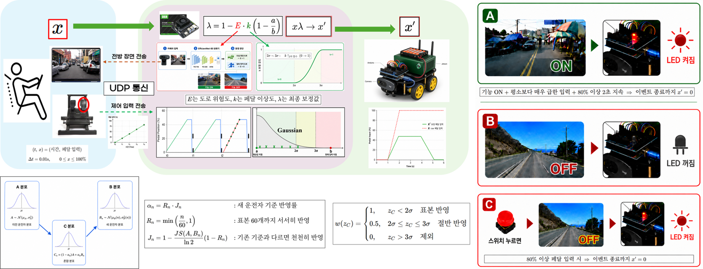

# Driver-Adaptive Smart Sudden Acceleration Control System

운전자 맞춤형 스마트 급가속 제어 시스템

아주대학교 미래모빌리티공학과  
(2026.03 ~ 2026.06)

## 시스템 아키텍처


## 작품 소개
고령 운전자와 초보 운전자의 생활 주행 중 페달 오조작 위험을 줄이기 위해, 운전자 특성과 주행환경 판단을 반영해 위험한 가속 입력을 차량 움직임 전 단계에서 완화하는 안전 제어 시스템입니다.

본 작품은 급가속 위험을 페달 입력 크기만으로 판단하지 않고, 입력이 얼마나 갑작스럽게 형성되었는지와 카메라로 판단한 현재 주행환경에서 위험한지를 함께 고려합니다. 같은 가속 입력이라도 천천히 밟은 경우와 순간적으로 급하게 밟은 경우는 안전 관점에서 다르기 때문에, 운전자의 평소 조작 특성과 주행환경을 반영해 정상적인 가속 의도는 존중하고 위험한 입력만 선택적으로 완화합니다.

## 기획 의도

고령 운전자와 초보 운전자는 주차장, 골목길, 후진, 정차 후 재출발처럼 짧은 시간 안에 정확한 페달 조작이 필요한 상황에서 순간적인 실수를 겪을 수 있습니다. 이 문제는 운전자 개인의 부주의만으로 보기보다, 위험한 입력이 차량 출력으로 이어지기 전 이를 완충하는 안전 보조 시스템의 문제로 볼 필요가 있습니다.

이에 본 작품은 운전자별 조작 특성과 주행환경을 반영해 불필요한 개입은 줄이고, 위험한 가속 입력만 선택적으로 완화하도록 기획했습니다.

## 핵심 기능

- 운전자별 페달 조작 특성 기반 baseline 학습
- 페달 변화율 기반 급가속 이상 입력 판단
- 카메라 기반 주행환경 인식
- 위험 환경에서만 선택적으로 가속 입력 보정
- Jetson, 노트북, Arduino 차량 간 UDP/Serial 기반 실시간 연동
- 실시간 영상 스트리밍 및 보정 페달값 모니터링

## 폴더 구성

```text
.
├─ notebook/          # 노트북 측 최종 실행 코드와 개발 과정 코드
├─ jetson/            # Jetson 측 추론, 페달 보정, 영상 스트리밍 실행 코드
├─ arduino_vehicle/   # Arduino 차량 제어 코드
└─ visualization/     # 최종 시연 영상 자료
```

각 폴더 안의 자세한 실행 방법은 해당 폴더의 `README.md`를 참고합니다.

## 구동 방법 요약

### 1. Arduino 차량 코드 업로드

Arduino IDE에서 아래 파일을 차량 아두이노 보드에 업로드합니다.

```text
arduino_vehicle/02_arduino_vehicle_final.ino
```

### 2. Jetson 실행

Jetson에서 `final_runtime` 폴더로 이동한 뒤, 노트북 IP를 넣어 실행합니다.

```bash
cd /home/jetson/Downloads/final_runtime
sudo chmod a+rw /dev/ttyUSB0
MPLCONFIGDIR=/tmp/matplotlib python3 jetson_main.py --serial-port /dev/ttyUSB0 --video-udp-host <NOTEBOOK_IP>
```

### 3. 노트북 실행

노트북에서 Jetson IP를 넣어 실행합니다.

```powershell
cd notebook
python .\notebook_main.py --ip <JETSON_IP>
```

기본 포트 구성:

- 노트북 -> Jetson 페달/핸들 UDP: `5005`
- Jetson -> 노트북 영상 UDP: `5000`
- Jetson -> 노트북 보정 페달 telemetry UDP: `5006`

## 시연 자료

`visualization/` 폴더에 최종 시연 영상이 포함되어 있습니다. GitHub에서 README를 열면 아래에서 바로 재생할 수 있도록 구성했습니다.

### 최종시연1차: 기능별 개별 실험

<video src="visualization/최종시연1차.mp4" controls width="100%">
  브라우저에서 영상을 표시할 수 없으면 visualization/최종시연1차.mp4 파일을 직접 열어 확인합니다.
</video>

[영상 파일 열기](visualization/최종시연1차.mp4)

### 최종시연2차: 통합 검증 실험

<video src="visualization/최종시연2차.mp4" controls width="100%">
  브라우저에서 영상을 표시할 수 없으면 visualization/최종시연2차.mp4 파일을 직접 열어 확인합니다.
</video>

[영상 파일 열기](visualization/최종시연2차.mp4)

## 기술 스택

- Python
- PyTorch / Torchvision
- OpenCV
- Pillow
- Matplotlib
- UDP Socket Communication
- Arduino Serial Communication
- Jetson Orin NX
- Arduino vehicle platform
